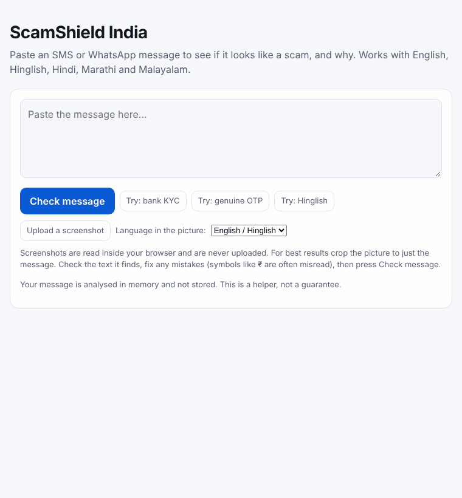
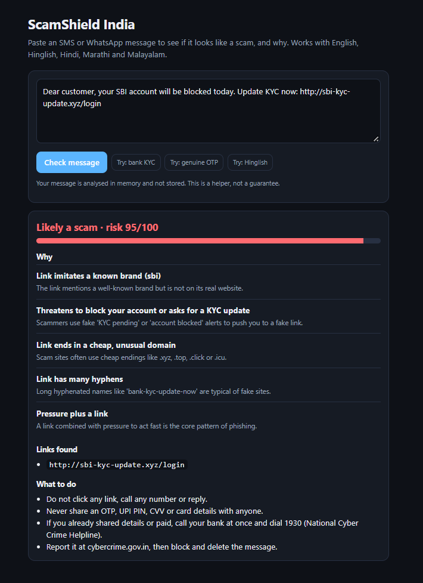

# ScamShield India

Paste an SMS or WhatsApp message and find out if it looks like a scam, **and why**, in plain words.
Built for the scams that hit India hardest: fake KYC alerts, UPI PIN tricks, digital arrest threats,
fake parcel and customs fees, fake loans, job offers and fake refunds. Works with English, Hinglish,
Hindi, Marathi and Malayalam.

> **Status: early prototype (116 automated tests pass).** The tool runs and has tests, but it has **not yet been measured on real
> scam messages**. See [What has been measured](#what-has-been-measured). It is a helper, not a guarantee.

**Live demo:** https://scamshield-india-wvyl.onrender.com  
*Free hosting: the demo sleeps when nobody uses it, so the first load can take about a minute.*

## Why this exists

Most people who fall for these scams are not technical, and most scam checkers only understand English
and give a verdict without a reason. ScamShield explains each warning sign, so people learn to spot the
next scam themselves.

## Demo





The message in the demo is made up, not a real person's message.

## Example

Made-up message: `Dear customer, your SBI account will be blocked today. Update KYC now: http://sbi-kyc-update.xyz/login`

Result: **95 / 100, likely scam**, because:

- The link imitates a known brand (sbi) but is not on its real website
- It threatens to block your account or asks for a KYC update
- The link ends in a cheap, unusual domain (`.xyz`)
- The link has many hyphens
- Pressure plus a link is the core pattern of phishing

It then tells the user what to do: do not click, never share an OTP, call 1930 (National Cyber Crime
Helpline) if money was lost, and report at cybercrime.gov.in.

## How it works

1. **Rule engine** (`app/rules.py`): explainable checks for OTP requests, look-alike bank links, arrest
   threats, fake refunds, shortened links and more. Each has a weight and a plain-language reason.
   Hindi, Marathi, Malayalam and Hinglish have their own word lists.
2. **Optional ML layer** (`app/ml.py`, `ml/train.py`): TF-IDF text features and logistic regression. It can
   only **raise** a score, and only when it is very confident, so it can never hide a scam the rules found.
   It is not trained yet, because there is not enough real data.
3. **Screenshot upload**: the page can read text from a screenshot (Tesseract OCR, English, Hindi, Marathi and
   Malayalam). It runs **inside the visitor's browser**, so the picture is never uploaded. The text is placed in
   the box so the user can fix mistakes before checking.
4. **Result** (`app/analyzer.py`): a 0 to 100 score, the reasons, the links found, and advice.
   60 and above = likely scam, 30 to 59 = suspicious, below 30 = "no strong signals" (never "safe").

Messages are analysed in memory and are not stored. The only exception is the optional feedback button, which saves nothing unless the visitor presses it (see Data and privacy).

## Run it

In a terminal, inside the project folder (Windows PowerShell):

```
python -m venv .venv
.venv\Scripts\activate
pip install -r requirements.txt
uvicorn app.main:app --reload
```

Open http://127.0.0.1:8000. On Mac or Linux, activate with `source .venv/bin/activate`.

Run the tests: `python -m pytest -q`

API: `POST /api/analyze` with `{"message": "..."}` returns the score, label, signals, links and advice.

## What has been measured

No result here is real accuracy yet. This is everything measured so far, and what each number means:

| Check | Result | What it means |
|---|---|---|
| Whole dev set (643 messages: 253 scam, 390 genuine), rules only, latest run | Precision 100% (97 to 100%, n=126). Recall **50%** (44 to 56%, n=253). English-only recall is **36%** (n=194); Hindi 95%, Marathi 93%, Malayalam 92%, Hinglish 100% (n=21, 15, 12, 11). 0 false alarms on 390 genuine. | **Optimistic, not accuracy.** The rules were tuned on this data. The English recall is low mainly because of UK-style public scams. The regional recall comes mostly from made-up and public-page messages. |
| Dev set, hand-written seed messages (41) and AI-drafted messages (90) | 100% precision and recall | **Not accuracy.** The rules were tuned on these messages. |
| Dev set, public SMS phishing data (483 messages: 165 scam, 318 genuine, all English) | Scam recall **25%** (95% range 19 to 33%, n=165). Precision 100% (91 to 100%, n=41). 0 false alarms on the 318 genuine messages in this part of dev. | First run was 10% recall. Most misses are UK-style scams (premium-rate numbers, pound prizes) that this India-focused tool is not built for. The rules were then fixed for the Indian-style misses, so these numbers are **optimistic**. |
| 18 freshly written scams, before the regional rules were extended | 7 of 18 flagged (39%) | Showed the first regional rules depended on exact wording and spelling. Fixed afterwards, so this check is now used up. |
| 12 freshly written genuine messages | 12 of 12 passed | Small and made up. |
| 4,827 normal English messages (UCI SMS Spam Collection) | 1 flagged (0.02%, 95% range 0.0 to 0.1%) | False-alarm check on casual chat, not on bank alerts. |
| Screenshot reading, smoke test: 4 made-up scam messages (English, Hindi, Marathi, Malayalam) drawn by a computer as clean images and uploaded through the real page in headless Chrome | Text matched the original 100%, 100%, 100% and 93% (character similarity). The Malayalam score stayed the same after a normalisation fix. | **Not accuracy.** Clean, computer-drawn text only. Real phone screenshots (chat bubbles, dark mode, compression, handwriting-style fonts) are untested. |
| 1,376 normal messages (casual chat) from a public Hugging Face dataset, `anmolshrivastav/scam-ham-india` (Apache-2.0) | Before fixes: **1 of 1,376 flagged** ("send me the wifi password" was read as an OTP request). After the fix: 0 of 1,376 flagged (0 to 0.3%). | False-alarm check on casual English chat only, not on bank alerts. The dataset card says it mixes real and synthetic messages, so this is not a test set. Its 895 "spam" rows are mostly promotions, with some scams mixed in. Genuine promos with short links used to score 35 to 40 ("Suspicious"), and genuine Airtel Xstream promo links were wrongly called brand look-alikes (fixed). A promotion cap was then added (see Limitations). On the latest run, 107 of the 895 "spam" rows (12.0%) score 30 or more. That is not a false-alarm or recall figure, because that set mixes promotions with real scams and is not labelled by us. |
| 24 scam messages in Hindi, Marathi, Malayalam and English, quoted on public web pages (bank, news and police pages), checked once with the rules **before** any change | **0 of 24 reached "Likely scam" (60+). 7 of 24 reached "Suspicious" (30+).** | First check on messages the rules had never seen. n is small, 6 of the 24 are the same electricity-bill scam, and the pages mostly show them as examples, not as messages someone really received. The rules were then fixed using these messages, so a later score on them (about 88% recall on the 25 public_web scams in dev) is **not accuracy**. This check is now used up. Two more public examples found later (a Marathi "government Diwali gift" message and a Malayalam "reply NO" message) were checked against the already-improved rules and scored only 20 and 15, so the earlier fixes did not carry over to new wording. Both were then added as rules. |
| Held-out test set (210 public messages: 66 scam, 144 genuine) | **Not run yet** | Kept unseen on purpose. It is English and mostly UK-style, so even a good result would say nothing about Hindi, Marathi or Malayalam. |

The Hindi, Marathi, Malayalam and Hinglish rules have only been checked on made-up messages. No real
messages in those languages have been collected yet, so their results above are **not evidence** of how the
tool performs in real life. Made-up messages are never used for testing. Details are in `data/COLLECTION_PLAN.md`.

## Telegram bot

Send or forward a message to the bot and it replies with the same score, reasons and advice as the website.
Create a bot with `@BotFather` on Telegram, then in PowerShell inside the project folder:

```
$env:TELEGRAM_BOT_TOKEN = "paste-your-token-here"
python -m bot.telegram_bot
```

It only replies with check results, never repeats your message, shows links with `hxxp` and `[.]` so they cannot be tapped, ignores group chats, and does not store or log message text. The token is a password: keep it out of git. It runs only while your computer runs the command, and screenshots are not supported in the bot yet.

## Limitations

- **No real-data accuracy for Indian languages yet.** The first check on real public examples was weak (see the table). Messages from public pages are labelled `public_web`, can tune the rules, and are never used in the test set. The regional numbers come from made-up messages, and the real messages measured so far are English and mostly UK-style.
- **Screenshot reading has had one real-world check.** A dark-mode iPhone screenshot of an English lottery SMS was read correctly, except that ₹ became % and the status bar and sender number were picked up as extra text. Three further made-up Hindi, Marathi and Malayalam screenshots (placeholder phone numbers) were also tried and used to improve the rules, so their scores are tuning examples, not accuracy. Expect more mistakes in Malayalam and in low-resolution pictures. Cropping to the message helps. The first use downloads a few MB of language data.
- Scammers disguise words (W0N, K.Y.C). The rules now undo the most common tricks, but new tricks will get through.
- Rules are keyword lists. They miss spelling variants and wording they do not list. A first quick check
  showed this clearly for Hindi, Marathi and Malayalam.
- Store and telecom promotions often have a short link and words like "hurry". If that is all the rules see, and the text has clear promotion wording ("T&C apply", "use code", "% off"), the score is capped at 25. A scam dressed as a promotion with only a short link and "hurry" would also stay low. Any stronger signal (prize, OTP, KYC, look-alike link, phone number) switches the cap off.
- Genuine bank, electricity and KYC reminders can look like scams. They score close to the "suspicious"
  line (25 to 30 out of 100), and some real promotions with short links score 40.
- Some rules skip a sentence part that contains "not", "never" or similar, so that real warnings ("never share your OTP") do not look like scams. A negation now only cancels its own part of the sentence (split at commas, colons, "but"), but a scam part that itself contains one of those words can still slip through.
- Scam wording changes constantly, so the rules need regular updates.
- The brand allow-list in `app/rules.py` has not been verified.
- The public demo has a simple in-memory rate limit (20 checks per minute per visitor, 300 overall). It resets when the server restarts and the visitor address can be faked, so it protects a free demo from accidents, not from a determined attacker. It was confirmed on the live site on 7 Nov 2026 (the limit message appeared after rapid clicks), but it has not been tested under real load.

- Visitor feedback is optional and unverified. Anyone can send it, so labels can be wrong or junk. On Render's free tier the disk is wiped on every restart or deploy, so saved feedback can disappear. Feedback rows are `user_feedback`: they can tune the rules, never the test set, and nothing from them counts as measured accuracy.

## What I learned

- **Tuned scores flatter you.** Every rule I fixed made the numbers on that data look better. The honest signals were the first checks on messages the rules had never seen: 0 of 24 public-page scams reached "Likely scam", and two later examples scored only 20 and 15 after earlier fixes. Fixing one wording rarely fixed the next.
- **False alarms matter as much as misses.** A scam checker that flags genuine bank alerts, promotions or "send me the wifi password" gets ignored. Checking against thousands of normal messages found real problems, and fixing them has trade-offs: the promotion cap now also lowers a scam that is dressed as a promotion.
- **Negation is hard.** "Never share your OTP" is a warning and "Never delay, share your OTP" is a scam. Cancelling a rule for the whole sentence missed the second, so a negation now only cancels its own part of the sentence.
- **Do not trust collected data without opening the sources.** One data file came with source links that did not support its messages, so none of it was used. Unverified data is kept out of the test set.
- **Privacy is part of the design.** Screenshots are read in the browser, feedback is saved only after a button press and an optional tick, and personal details are removed before anything is stored.

## Roadmap

- [ ] Collect real Hindi, Marathi, Malayalam and Hinglish messages (with permission, personal details removed) for a real test set
- [ ] Measure precision and recall on that test set and report the numbers here
- [ ] Review and extend the Hindi, Marathi and Malayalam rules with real examples
- [ ] Train and evaluate the ML layer on real data
- [x] Handle screenshots (OCR) so people can upload a picture of the message (browser-side, needs testing on real screenshots)
- [x] Optional "Was this right?" feedback button (text saved only with a tick; see Data and privacy)
- [x] Telegram bot (runs on your own computer, text only; tried on real Telegram by the author)
- [x] Deploy a live demo (Render free tier)
- [x] Add a rate limit to the public demo

## Project structure

```
app/        FastAPI app, rule engine, ML layer, analyzer
bot/        Telegram bot (uses the same analyzer)
static/     Web interface (static/vendor/ocr holds the screenshot-reading files, see its README.txt)
data/       Dataset (messages.csv) and the collection plan
ml/         Training, dev/test split, evaluation and stress-test scripts
tools/      Personal-detail scrubber and dataset helper
tests/      Unit and data tests
docs/       Screenshot and demo GIF used in this README
```

## Data and privacy

- Screenshots are read in the browser and never sent to the server.
- Feedback buttons: nothing is saved unless a visitor presses one. Only the score shown, the verdict shown, the answer and the date are kept. The message text is kept only if the visitor ticks the box. It is cleaned first (phone, account, card, Aadhaar, PAN, email, UPI id, OTP) and dropped if personal details are still visible. Names are not reliably removed, so the page tells visitors to edit them out. No IP address is stored. The owner can download the file at `/api/feedback/export?token=...` only if the `FEEDBACK_TOKEN` environment variable is set; otherwise that address does not exist. `tools/import_feedback.py` loads an export as `user_feedback`, after which you should read every row yourself.
- Personal details (names, phone numbers, account numbers, OTPs) are removed before a message is saved.
- Only messages given with permission, or public datasets with a suitable licence, are used.
- Made-up or unverified messages (`self_written`, `synthetic_ai`, `public_web`, `user_feedback`) are labelled, may tune the rules, and are never used for testing.
- Public SMS phishing messages come from the Mendeley Data set "SMS Phishing Dataset for Machine Learning and Pattern Recognition" (CC BY 4.0, authors listed at https://data.mendeley.com/datasets/f45bkkt8pr/1). Personal details are removed, and 'spam' (promotion) rows are not used. Cleaned copies are in `data/messages.csv`.
- Stress tests use the UCI SMS Spam Collection (Almeida, Gomez Hidalgo and Yamakami, 2011; CC BY 4.0).
- False-alarm check on casual chat: `anmolshrivastav/scam-ham-india` on Hugging Face (Apache-2.0), kept outside the repo in `data/external/`.
  It is English, mostly UK and Singapore messages, and is not included in this repository.

## Author

[Siddhanthaditiyaa Vettakal](https://github.com/siddhanthaditiyaa-beep) ·
[LinkedIn](https://www.linkedin.com/in/siddhanthaditiyaa-vettakal)
